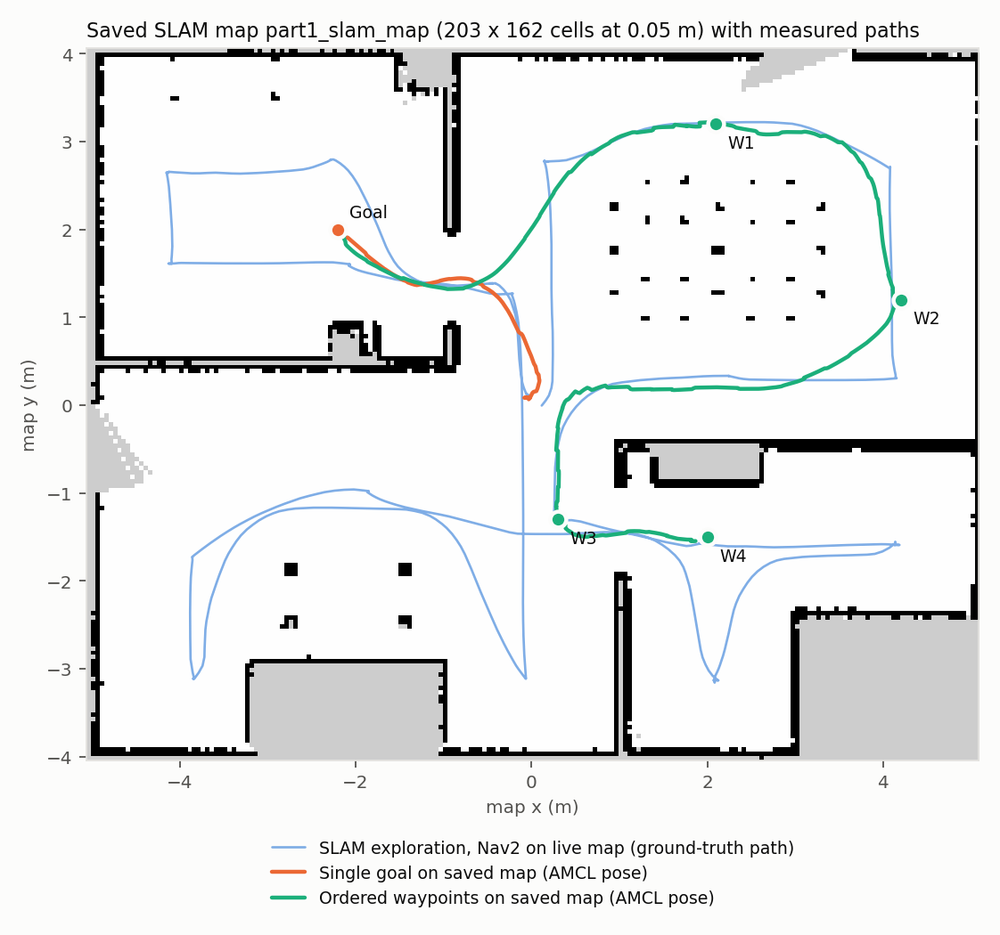
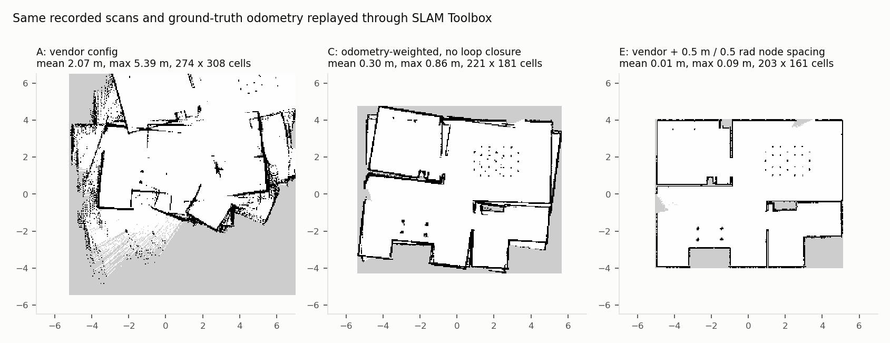
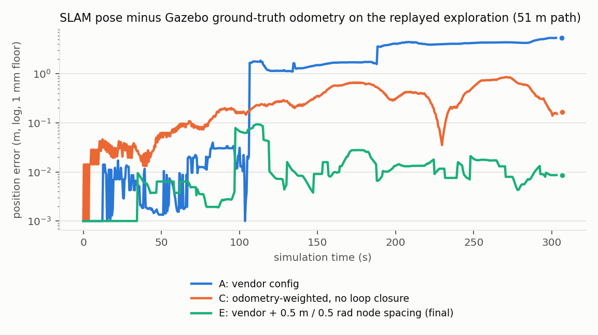

# Part 1 — ROSOrin Pro simulation

## Objective and setup

Part 1 asks for the ROSOrin Pro to run in Gazebo with these capabilities:

- driving the robot by command;
- showing its simulated LiDAR;
- building a map with SLAM and saving it;
- navigating autonomously on that saved map, both to a single goal and through ordered waypoints.

No physical robot was used. The guest was Ubuntu 22.04.4 with ROS 2 Humble, Ignition Gazebo Fortress 6.16.0, Nav2 1.1.14 and SLAM Toolbox, running in VirtualBox 7.2.10 (6 vCPUs, 6 GB RAM). The host was an i5-13420H laptop. The VM renders with Mesa in software. The Gazebo server ran without its 3D client during mapping and navigation, and RViz2 provided the visualization. Before any ROS work could start, the VM had to be repaired: it stopped at boot in emergency mode, caused by expedited-RCU stalls rather than a missing EFI partition. That fix is documented separately in `BOOT_RECOVERY.md`.

**Data flow.**

- Fortress `MecanumDrive` moves the wheels.
- Fortress `OdometryPublisher` derives `/odom` and `odom → base_footprint` from the model's simulated pose.
- `ros_gz_bridge` carries `/clock`, `/scan`, odometry and `/cmd_vel` between Gazebo and ROS.
- During mapping, SLAM Toolbox owns `map → odom`. Nav2 runs on SLAM's live `/map` (`use_localization:=false`) and drives the exploration.
- During navigation, map_server loads the saved map and AMCL owns `map → odom`.
- Nav2 uses Navfn, the Regulated Pure Pursuit controller (replacing the vendor's DWB, see problem 3) and the velocity smoother.
- Every node uses simulated time.

**Acceptance.** `scripts/navigation_test.py` sends the real Nav2 actions. The acceptance limits are 0.25 m and 0.25 rad, the vendor's original goal tolerance. The controller's goal checker aims tighter (0.15 m / 0.15 rad), so braking and drift cannot carry the stopped pose past the limits. A run passes only when all of these hold:

- the action status is 4;
- `missed_waypoints` is empty;
- every waypoint has a TF-measured arrival inside the limits while it is the active waypoint;
- the final pose, measured after odometry shows the robot has stopped, is inside the limits.

A displayed path or an accepted goal never counts as success.

## Results

All numbers come from one continuous recorded session with the final configuration (`evidence/full_slam`). A separate run of the README commands on a freshly spawned robot reloads the saved map from the package (`evidence/controller_check`).

| Task | Measured result |
|---|---|
| Control (0.05 m/s for 2 sim-s; 0.25 rad/s for 3 sim-s) | odometry: +0.1005 m forward; +0.829 rad turn, with 0.017 m of drift while turning |
| LiDAR | 270 beams over ±1.36 rad, 10 Hz; all scans valid, about 260 finite returns each; RViz shows the scan aligned with the walls |
| SLAM exploration (4 Nav2 routes, 21 waypoints, 52.4 m path) | 4/4 actions succeeded, 21/21 waypoints reached; SLAM pose error against ground truth: mean 0.023 m, max 0.058 m, max 0.021 rad; 0 loop-closure corrections |
| Saved map `part1_slam_map` | 203 × 162 cells at 0.05 m (10.15 × 8.1 m; the house is 10.2 × 8.1 m); 27,382 free, 1,921 occupied, 3,583 unknown cells |
| Single goal (−2.2, 2.0, π), north-west room through a doorway | status 4, PASS; settled error 0.103 m / 0.005 rad; 39.8 s including AMCL initialization |
| Multi-point, 4 ordered poses across 3 rooms | status 4, missed `[]`, PASS; arrivals 0.143 / 0.100 / 0.144 / 0.141 m; final 0.141 m / 0.039 rad; 123 s |
| README check, fresh spawn, map reloaded (`controller_check`) | single goal 0.151 m / 0.014 rad; 4 waypoints, final 0.144 m / 0.087 rad; U-turn regression route (problem 3), final 0.122 m / 0.058 rad. All status 4 and PASS; 0 progress-checker failures |

The pre-existing `map_01`, whose origin is unknown, is unchanged and unused by the final runs (SHA-256 hashes are recorded in each run). The saved map is now part of the package in `maps/`.

## Problems, root causes and fixes

**1. SLAM produced distorted maps (main finding).** The first full exploration, using the vendor SLAM configuration, built a 12.5 × 16.5 m map of a 10 × 8 m house, with doubled walls. A logger compared SLAM's `map → base` pose with Gazebo's ground-truth odometry and measured the error directly.

- Run 1 (vendor configuration): 1.7 m and 0.84 m jumps. Each one coincided to the millisecond with a Ceres loop-closure solve in `slam.log`.
- Run 2 (loop closure off): the jumps stopped. Error stayed below 0.18 m until an in-place turn in the north-west room, where SLAM's yaw froze while the robot turned 1.6 rad.
- Run 3 (odometry-weighted scan-matching penalties): the error was bounded but still reached 0.86 m. The map was usable, but its north-west room was rotated.

To separate sensor errors from algorithm errors, the recorded scans were ray-cast against the world's wall geometry. Mean residual was 0.010 m, equal to the configured noise. The best time offset was 0 s, and there was no angle offset or scale error. These checks supported investigating SLAM configuration; they did not prove that every input was exact. The same rosbag was then replayed through SLAM Toolbox with five configurations (`evidence/slam_replay`):

| Config (same recorded data) | Mean / max pose error | Map size |
|---|---|---|
| A: vendor (`minimum_travel` 0.0 m / 0.01 rad, loop closure on) | 2.07 / 5.39 m | 274 × 308 |
| B: A with loop closure off | 0.26 / 0.88 m | 226 × 178 |
| C: B plus odometry-weighted penalties | 0.30 / 0.86 m | 221 × 181 |
| D: B with `minimum_travel` 0.5 m / 0.5 rad | 0.013 / 0.093 m | 203 × 161 |
| **E: A with `minimum_travel` 0.5 m / 0.5 rad (final)** | **0.013 / 0.093 m** | **203 × 161** |

The cause was the vendor's `minimum_travel_distance: 0.0`, `minimum_travel_heading: 0.01`. With those values, SLAM adds and scan-matches a new pose node every 0.5 s, even while the robot is standing still or turning in place. With a 156° LiDAR, small matching errors pile up over about 600 nodes, and loop closure then snaps onto look-alike scans on the two sides of 0.1 m walls. SLAM Toolbox's defaults (0.5 m / 0.5 rad) fix both problems while keeping scan matching and loop closure, and the final live run confirmed the replay: 0.023 m mean and 0.058 m maximum error. My earlier fixes (turning off loop closure, adding penalties) treated symptoms. The replay showed this, and they were reverted.

**2. Lost ROS service replies.** Twice, a request appeared to be sent but no reply ever came. Once the reply to the test client's `GetParameters` call was missing. The other time, AMCL's reply to the lifecycle manager's `change_state` call was lost, and Fast-DDS logged `failed to send response ... client will not receive response`. The localization manager then blocked forever, and AMCL ignored the initial pose because it was "not yet in the active state". This is a discovery race under heavy CPU load from software rendering. The helper now retries service calls. It waits for AMCL to be active before it sends the initial pose, and resends the pose only if no `map → odom` transform appears. If a manager stays blocked for more than 30–40 s, the helper completes the standard configure/activate transitions itself and records them in `lifecycle_recovery`. The final runs needed no recovery (`lifecycle_recovery: []`).

**3. Controller stuck by a goal just behind a wall.** The vendor controller was DWB. On a route from (4.2, 1.2) to (2.0, −1.5), it stopped 0.75 m short of the wall and reported "Failed to make progress" 16 times. That goal is 1.8 m away in a straight line but about 4 m along the path, through a doorway, and the global plan was correct. The same thing happened in three runs, including one with an accurate map, so the map was not the cause. Leaving the north-west room through its doorway also stalled DWB for about 210 s in one run. DWB's goal-distance critics form a local minimum wherever the plan U-turns around a thin wall.

- Enabling the static map layer in the local costmap did not help: the same route still failed (`evidence/debugging/dwb_static_layer.json`).
- Switching to Regulated Pure Pursuit, which follows the plan, fixed it. The first RPP trial still stopped on "collision ahead": the plan skimmed the dining chairs and the lookahead arc cut the corner (`evidence/debugging/rpp_collision.json`). Widening the global inflation (0.3 → 0.55 m, scaling 10 → 3) keeps plans centred, and a shorter lookahead (0.4 m) cuts fewer corners.
- With the final settings, the failing route (`scripts/uturn_waypoints.json`), the README routes and the recorded session all pass with zero progress-checker failures.
- The same change fixed a second problem. With the goal checker at the 0.25 m / 0.25 rad acceptance limits, DWB stopped the moment the robot entered tolerance, so errors clustered at 0.23–0.25. A single goal once failed acceptance by 0.001 rad. The goal checker now targets 0.15 m / 0.15 rad, and settled errors are 0.10–0.15 m and at most 0.09 rad.

**4. Earlier fixes still in place.** These were found before the SLAM work, each measured against a baseline, and are listed in `MODIFIED_FILES.md`:

- An unconditional static identity `map → odom` conflicted with AMCL and SLAM; it was removed.
- Two Gazebo plugins published `/odom`; the drive's copy was moved to `/wheel/odom`.
- The drive plugin's wheel geometry (0.05 / 0.30 / 0.34 m) did not match the model (0.04 / 0.16 / 0.18 m). A 0.10 m command moved the robot 0.080 m before the fix and 0.1005 m after.
- The baseline goal checker could accept a goal 0.256 m away, because it latched XY before the final turn. It is now non-stateful and tighter (problem 3).
- The 0.07 m footprint was too small; it is now 0.19 m.
- The ros2_control path aborted because the URDF has no `ros2_control` tag, so it was removed.
- The `nav` launch argument was not forwarded, and the EGL headless LiDAR returned only infinite ranges. Both were fixed or avoided.

## Limitations

The simulation runs at 0.53–0.75× real time with software rendering. Ground-truth odometry makes this setting easier than a real robot. On hardware, wheel-odometry drift would make loop closure essential, and the same replay method should be used to tune it against a reference. The robot's in-place rotation centre is offset about 2 cm from `base_footprint`, so a final turn of about 180° shifts it 2–4 cm. In a pre-final RPP trial (`evidence/debugging/rotation_reapproach.json`) this caused two re-approaches, which Nav2's recoveries cleared; the final runs had none. The tests cover the chosen routes in a static house over a few runs each, which is not a reliability benchmark. The current demo is a command walkthrough; the numerical results above come from the retained action and pose logs.
